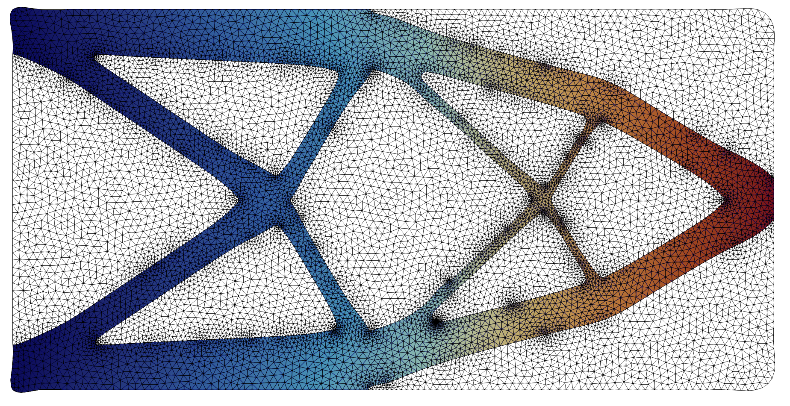

# sotutox

`sotutox` is a compact FEniCSx/DOLFINx port of the 2D body-fitted compliance
optimization examples from [`sotuto`](https://github.com/dapogny/sotuto) of Charles Dapogny et al.



Final cantilever layout from `examples/cantilever.py`, rendered from the saved
MMG/VTU output.

The code keeps the examples small enough to read, but the optimization path is
real: MMG remeshes the level-set interface, the solid phase is extracted as a
body-fitted submesh, elasticity is solved on that submesh, and ParaView output
is written for every saved iteration.

## What Is Included

Four examples are exposed through thin runners:

- `examples/cantilever.py`: the circular-hole cantilever setup from
  `sotuto/base`.
- `examples/bridge.py`: the MBB-style bridge setup from `sotuto/topder`,
  including periodic topological derivative hole creation.
- `examples/l_beam.py`: the L-beam hold-all and hole pattern from
  `sotuto/stress`, run with the current compliance/volume optimizer.
- `examples/multiload_bridge.py`: the long perforated bridge geometry from
  `sotuto/constraints`, run with the current single-load compliance/volume
  optimizer.

The reusable implementation is in `sotutox/`:

- `sotutox/parameters.py`: generic numerical, physical, MMG, and optimizer
  parameter container.
- `sotutox/geometry.py`: rectangular hold-all mesh initialization and graph
  redistancing. Example-specific level-set formulas live in `examples/`.
- `sotutox/redistance.py`: dependency-light graph signed-distance helper.
- `sotutox/mmg.py`: Medit I/O and `mmg2d_O3` calls.
- `sotutox/mechanics.py`: fitted solid extraction, elasticity, compliance,
  volume, and interface shape gradients.
- `sotutox/optimization.py`: null-space descent and merit function.
- `sotutox/topology.py`: `sotuto/topder` topological derivatives and hole
  creation.
- `sotutox/advection.py`: SUPG and characteristic level-set advection.
- `sotutox/optimization_mmg.py`: shared MMG-remeshed optimization loop and
  writers. It receives example-specific level-set and boundary callbacks from
  the runner.
- `examples/common.py`: shared command-line handling for example runners.
- `examples/*.py`: benchmark constants, initial level sets, optional initial
  mesh factories, boundary markers, and runners.
- `tools/diagnose_mmg_step.py`: optional developer diagnostic, not part of the
  core example path.

## Differences From Original Sotuto

- The solver stack is FEniCSx/DOLFINx, UFL, PETSc, and Python instead of
  FreeFEM scripts.
- `MshDist` is not required. Redistancing is handled by
  `sotutox.mmg.distance_level_set_from_tags`. Inside that function,
  `sotutox.mmg._phase_seed_values` builds the solid/void/interface seed values
  from MMG tags, then `sotutox.redistance.graph_signed_distance` propagates the
  signed distance over the mesh-edge graph. This is a custom Dijkstra-style
  graph march using Python `heapq`; NumPy is used for array operations and
  Euclidean edge lengths through `numpy.linalg.norm`.
- The FreeFEM `Advection` plugin is not required. The default advection is an
  implicit Euler/SUPG FEniCSx solve; native `midpoint` and `euler`
  characteristic transports are available for small serial runs.
- The `sotuto/topder` bridge's periodic topological derivative hole creation is
  implemented natively in `sotutox/topology.py`. It is enabled by default for
  `examples/bridge.py` and disabled by default for `examples/cantilever.py`.
  The bridge runner keeps the original `0.01` removed-volume fraction, but it
  also rejects near-interface and speckle-sized topological components through
  `topological_min_distance_from_interface` and
  `topological_min_hole_radius`. After accepted remeshes, the bridge also runs
  a small-void cleanup through `void_cleanup_min_hole_radius` so shrunken
  isolated holes do not persist as artifacts.
- The `sotuto/stress` and `sotuto/constraints` geometries are available as
  example runners, but their original optimization objectives are not yet
  ported. `sotuto/stress` uses a stress functional and adjoint; `sotuto/constraints`
  minimizes volume with several compliance inequality constraints. The current
  runners reuse the compliance objective with one volume constraint.
- `sotuto/base3d` is not ported yet. The current MMG wrapper writes and reads
  2D triangular Medit meshes and calls `mmg2d_O3`; a faithful 3D example needs
  tetrahedral Medit I/O, `mmg3d`, and 3D output writers.
- The SUPG UFL form is cached per mesh/function-space pair, so line-search
  trials update coefficients instead of recompiling the form each time.
- ParaView output is written as XDMF/HDF5 plus PVD/VTU time series for both the
  parent fitted mesh and extracted solid submesh.
- The initial boundary segmentation follows `sotuto`, but DOLFINx does not
  reproduce FreeFEM/Bamg's exact initial interior triangulation.

## Install

Create the conda environment from the included file:

```bash
conda env create -f environment.yml
conda activate sotutox
```

Equivalent explicit install command:

```bash
conda create -n sotutox -c conda-forge \
  python "fenics-dolfinx" mmgsuite meshio numpy scipy matplotlib pytest
conda activate sotutox
```

Check the installation:

```bash
python -c "import dolfinx, meshio, scipy; print(dolfinx.__version__)"
which mmg2d_O3
```

`mmg2d_O3` is found from the active conda environment. If it is not on `PATH`,
pass it explicitly with `--mmg-binary /path/to/mmg2d_O3`.

The example runners add the repository root to `sys.path`, so editable
installation is not required for local runs. If you want normal package imports from notebooks or
external scripts, install the package metadata without changing the conda
solver environment:

```bash
python -m pip install -e . --no-deps
```

## Run Examples

From the repository root:

```bash
python examples/cantilever.py --iterations 1 \
  --mmg-hmax 0.05 --mmg-hmin 0.005 \
  --output-dir results_cantilever_smoke
```

For the bridge/MBB-style setup with `topder` hole creation:

```bash
python examples/bridge.py --iterations 10 \
  --output-dir results_bridge
```

Additional geometry ports:

```bash
python examples/l_beam.py --iterations 10 --output-dir results_l_beam
python examples/multiload_bridge.py --iterations 10 \
  --output-dir results_multiload_bridge
```

Useful switches:

- `--advection supg`: default implicit Euler/SUPG transport.
- `--advection midpoint` or `--advection euler`: serial characteristic
  transports.
- `--no-topological-derivatives`: disable the bridge/topder hole-creation
  branch.
- `--topological-volume-fraction 0.03`: remove a larger solid fraction during
  each accepted topological update.
- `--topological-min-distance-from-interface 0.15`: only inject holes this far
  inside the current solid.
- `--topological-min-hole-radius 0.04`: prune newly-created hole components
  whose equivalent radius is smaller than this value.
- `--void-cleanup-min-hole-radius 0.04`: remove accepted void components whose
  equivalent radius is smaller than this value; `0` disables cleanup.
- `--no-xdmf`: skip ParaView files for faster tests.

## Visualize Output

Open these files in ParaView:

- `steps.pvd`: parent fitted mesh with `phi`, `solid_indicator`, parent
  `displacement`, and, for non-final iterations, `grad_compliance`,
  `grad_volume`, and `descent_velocity`.
- `solid_steps.pvd`: extracted solid submesh with `solid_displacement` and
  solid-boundary facet labels.

Each output directory also contains:

- `history.csv`: iteration diagnostics. A `line_search` value of `-1` denotes
  a topological derivative hole-creation update.
- `step_*.xdmf`/`.h5`: DOLFINx/XDMF output for each saved parent mesh.
- `step_*_solid.xdmf`/`.h5`: DOLFINx/XDMF output for each saved solid submesh.
- `vtu/*.vtu`: files referenced by the PVD time series.
- `mmg/*.mesh` and `mmg/*.sol`: Medit/MMG exchange files.

## Tests

The dependency-light graph redistance tests can be run with:

```bash
python -m pytest -q tests
```

## License And Contact

Copyright (C) 2026 ONERA.

This project is licensed under the GNU Lesser General Public License version 3
or later (`LGPL-3.0-or-later`), matching the LGPL family used by the upstream
`sotuto` code.

Contact author: Susanne Claus <susanne.claus@onera.fr>.
